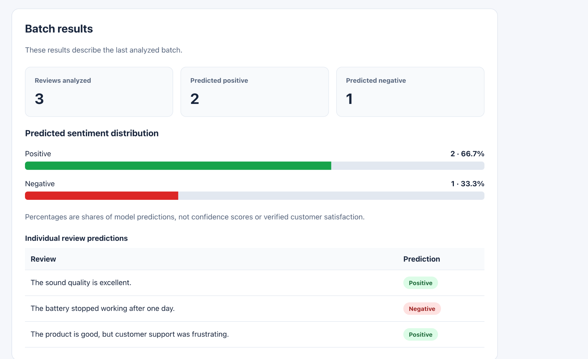

# Customer Feedback Intelligence

An NLP project exploring sentiment classification of customer review
sentences. I am building this project in public and documenting the
experiments, results, and limitations.

**Status:** Working local application with single-review and batch
predictions, visual summaries, and seven passing API integration tests.
Mobile/browser verification is pending.

## Completed

- Loaded 1,000 Amazon review sentences
- Prepared a cleaned dataset containing 987 sentences
- Created training, validation, and test splits
- Trained a dummy baseline
- Compared TF-IDF with logistic regression and Multinomial Naive Bayes
- Inspected validation errors and vocabulary coverage

## Validation results

Models were trained on 591 sentences and evaluated on 198 validation
sentences.

| Model | Accuracy | Macro F1 | Errors |
| --- | ---: | ---: | ---: |
| Dummy baseline | 50.0% | 0.333 | 99 |
| Logistic regression | 79.3% | 0.793 | 41 |
| Multinomial Naive Bayes | 78.8% | 0.788 | 42 |

Both trained classifiers misclassified 33 of the same validation sentences.
Their accuracy differs by one correct prediction; this single split does
not establish a general winner.

**The final test set remains untouched.**

## Current experiment

Testing whether changing TF-IDF's minimum document frequency from 2 to 1
affects vocabulary size and validation performance. Results are pending.

## Planned work

- Complete error analysis and model selection
- Evaluate the selected approach on the held-out test set
- Build a FastAPI prediction service
- Build a React interface with visual summaries
- Add tests and setup documentation

## Tools

Python, pandas, NumPy, scikit-learn, matplotlib, and Jupyter notebooks.

## Dataset and limitations

Source: [UCI Sentiment Labelled Sentences](https://archive.ics.uci.edu/dataset/331/sentiment+labelled+sentences),
Amazon subset.

Citation: Kotzias, D. (2015). Sentiment Labelled Sentences [Dataset].
UCI Machine Learning Repository.
https://doi.org/10.24432/C57604

Dataset license: [CC BY 4.0](https://creativecommons.org/licenses/by/4.0/).

Processed copies are derived from the source dataset using the cleaning
and splitting steps documented in the notebook.

This is a small, curated sample with positive and negative labels.
It contains no neutral class and does not represent overall customer
satisfaction. Results are not evidence of production readiness.## Selected model and final evaluation

The selected pipeline uses TF-IDF with unigrams and bigrams, `min_df=1`,
and logistic regression.

It was trained on 591 sentences. Model selection used a separate
198-sentence validation set.

| Evaluation set | Accuracy | Macro F1 |
| --- | ---: | ---: |
| Validation | 80.3% | 0.803 |
| Final test | 76.3% | 0.763 |

The final test contained 198 sentences: 151 predictions were correct
and 47 were incorrect. Test results were not used to tune the model.

These results come from a small, curated dataset and do not establish
production readiness.

## Application features

- Single-review sentiment prediction
- Batch analysis of up to 100 reviews
- Positive and negative prediction counts
- Visual distribution of batch predictions
- Individual review results table
- Input validation and error messages

The model predicts one positive or negative label per review. It cannot
identify neutral sentiment or separately classify mixed opinions.

## Run the application

Activate the project's virtual environment and install dependencies
from the project root:

```bash
source .venv/bin/activate
python -m pip install -r requirements.txt
```

The API requires `models/sentiment_pipeline.joblib`. Model binaries are
excluded from Git. Generate this file using the model-training and
model-saving cells in `notebooks/01_feedback_analysis.ipynb`.

Start the backend:

```bash
python -m uvicorn backend.main:app --reload --port 8002
```

In another terminal, start the frontend:

```bash
npm --prefix frontend ci
npm --prefix frontend run dev -- --port 5173 --strictPort
```

- Dashboard: <http://localhost:5173/>
- API documentation: <http://127.0.0.1:8002/docs>

## Verification

Keep the backend running, then execute from the project root:

```bash
python -m unittest discover -s backend/tests -v
npm --prefix frontend run lint
npm --prefix frontend run build
```

The seven API integration tests cover health, prediction consistency,
batch summaries, and invalid inputs.

## API endpoints

| Method | Endpoint | Purpose |
| --- | --- | --- |
| GET | `/api/health` | API health check |
| POST | `/api/predict` | Predict one review |
| POST | `/api/predict/batch` | Predict up to 100 reviews ## Batch prediction demo



Three illustrative reviews produced two positive predictions and one
negative prediction. Percentages represent prediction shares, not model
confidence or verified customer satisfaction.

Manually checked:
- Single-review predictions in the browser.
- Batch predictions, summary counts, and review order.
- Mobile layout at 390 px.## Verification

- Seven API tests passed.
- Frontend lint and production build passed.
- Single and batch predictions verified in the browser.
- Batch counts and review order checked.
- Mobile layout checked at 390 px.
- Backend outage displays an error and allows another submission.
- Predictions recover after restarting the backend without refreshing the page.

## Model results and limitations

The selected TF-IDF and logistic regression model correctly classified
151 of 198 held-out test sentences, achieving 76.3% accuracy.

The model predicts positive or negative sentiment only. It does not
separately identify neutral sentiment, mixed opinions, or sentiment
about individual product or service aspects.|